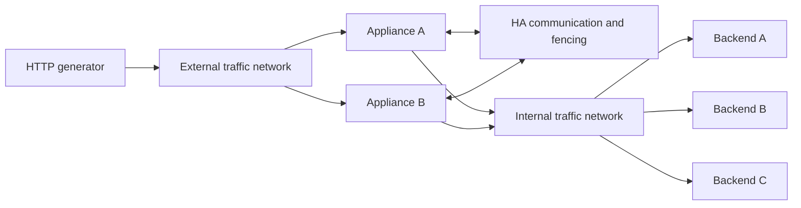

# RiverLB appliance qualification and traffic test plan

This is a repeatable **release qualification plan**, not a claim that the appliance
has passed it. Run destructive and capacity cases only in a dedicated lab. The
included scripts do not discover production targets or configure a hypervisor.
Results apply to the tested build, platform, resources and enabled features.

## 1. Scope and release gates

Qualify installation, local administration, networking, health monitoring,
TCP/UDP/HTTP traffic, certificates, RiverRules, persistence, configuration changes,
statistics, HA and signed offline updates. Test two independent appliances and
real backends before releasing an HA-capable image. Single-appliance tests can
start immediately; they cannot qualify failover or fencing.

Current scope: TCP full proxy, generic UDP proxy and HTTP/1, client/server TLS,
WebSocket and SSE. UDP forwarding uses idle client-endpoint flows; it does not
provide DTLS termination or QUIC connection-ID-aware routing. See [UDP behavior](udp-load-balancing.md).
Do not advertise HTTP/2, gRPC, live TCP/TLS session replication, hitless failover,
HA rolling updates or OS rollback based on these tests. See
[release readiness](release-readiness.md) and [HA behavior](high-availability.md).

Proposed initial gates, to approve before recording a release result:

| Gate | Acceptance |
| --- | --- |
| Correctness | Every mandatory case below passes; no unresolved critical/high defects |
| Stable traffic | Zero unexpected transport, TLS, HTTP status or payload failures during baseline/soak; deliberate fault windows reported separately |
| Balancing | 300 sequential fresh connections, three healthy equal-weight members, no persistence: each receives 100; concurrent tests assess totals, not strict ordering |
| Performance | Establish capacity per supported hardware profile; three runs per point; no invented universal Gbit/s or CPS target |
| Regression | At matched load and hardware, investigate >10% throughput loss or >20% p99 increase from approved baseline; thresholds are proposed policy |
| Apply responsiveness | Metadata-only change p95 <2 s on reference lab while serving traffic; no synchronous health-probe wait; report network/certificate changes separately |
| Failover | Exactly one traffic owner throughout; no standby serving before old owner is stopped/fenced; proposed controlled failover recovery <10 s, fault recovery budget defined from actual fencing timers |
| Soak | 24 h at 50% measured sustainable capacity; final qualification 72 h; no crash, unexplained failure or continuing memory/FD growth after warmup |
| Security/update | Invalid credentials, TLS trust failures, unauthorized operations and unsigned/tampered/replayed updates rejected; valid standalone update preserves state |

Failover recovery is the interval from the recorded event to the first **five
consecutive successful fresh requests**. Report polling interval, detection time,
fencing time and ownership time separately. Established connections may close;
count those separately from fresh connection recovery. Never remove fencing to
meet a timing target.

## 2. Lab inventory and addresses

Use isolated RFC 2544 benchmarking space, with no route to the public Internet
from the traffic segments. Keep a separate management network with recovery
console access. These are example addresses, not automatic assignments.

| System | Starting allocation | Management | External traffic | Internal/backend |
| --- | --- | --- | --- | --- |
| Appliance A | 4 vCPU, 8 GiB RAM, 30 GiB disk, 3 NICs | 192.0.2.11/24 | 198.18.10.1/24 | 198.18.20.1/24 |
| Appliance B | Same as A | 192.0.2.12/24 | 198.18.10.2/24 | 198.18.20.2/24 |
| Backend A | 2 vCPU, 2 GiB RAM | Separate admin access | — | 198.18.20.11/24 |
| Backend B | Same | Separate admin access | — | 198.18.20.12/24 |
| Backend C | Same | Separate admin access | — | 198.18.20.13/24 |
| HTTP generator | 4 vCPU, 4 GiB RAM | Separate admin access | 198.18.10.50/24 | Optional direct-baseline NIC |
| HA-only floating backend source | HA-owned object | — | — | 198.18.20.100/24 |
| Floating HTTP VIP | HA-owned object | — | 198.18.10.100:8080 | Pool A/B/C:8080 |


| System | Starting allocation | Management | External traffic | Internal/backend |

| riverlb-test-a | 2 vCPU, 2 GiB RAM, 30 GiB disk, 3 NICs | 10.10.2.11/24 | 10.10.10.10/24 | 10.10.20.10/24 |
| riverlb-test-b | 2 vCPU, 2 GiB RAM, 30 GiB disk, 3 NICs | 10.10.2.12/24 | 10.10.10.20/24 | 10.10.20.20/24 |


| Backend A | 2 vCPU, 2 GiB RAM | Separate admin access | — | 198.18.20.11/24 |
| Backend B | Same | Separate admin access | — | 198.18.20.12/24 |
| Backend C | Same | Separate admin access | — | 198.18.20.13/24 |
| HTTP generator | 4 vCPU, 4 GiB RAM | Separate admin access | 198.18.10.50/24 | Optional direct-baseline NIC |
| HA-only floating backend source | HA-owned object | — | — | 198.18.20.100/24 |
| Floating HTTP VIP | HA-owned object | — | 198.18.10.100:8080 | Pool A/B/C:8080 |


Reserve a separate protected HA communication path and working out-of-band
fencing for **both** appliances. The HA path may use an additional NIC or a
properly isolated network. Consult the HA guide for node-local versus floating
objects: do not synchronize A's unique self IP onto B. For HA, use the floating
backend source or an explicitly tested node-specific SNAT design, rather than
assuming standalone automap remains correct after movement.



Start with untagged networks. Repeat networking and failover cases with VLANs
11/12 and each intended virtual switch/NIC model. Record MAC-to-Linux-interface
mapping; never assume `eth1` means external. Record MTU, guest offloads, vCPU
pinning/NUMA, host overcommit, NIC/link speed, hypervisor version and storage.
Do not change offloads between runs without recording a new test variant.

## 3. Build, evidence and installation

Create a new results directory per run on a filesystem with adequate free space:

```bash
RUN=/tmp/riverlb-qualification-$(date -u +%Y%m%dT%H%M%SZ)
mkdir -m 700 "$RUN"
git rev-parse HEAD > "$RUN/git-head.txt"
git status --short > "$RUN/working-tree.txt"
sha256sum dist/iso/riverlb-installer.iso > "$RUN/iso.sha256"
```

For working-tree builds also retain a private source snapshot or patch and a
SHA256 manifest of included source files; a commit ID alone does not identify
uncommitted changes. Keep release/RPM identifiers, build logs and verification
JSON. Record UTC timestamps, time synchronization status and tool versions on
all systems. Results may contain client headers/addresses; use synthetic data
and restrict access. Do not export passwords, private keys or session tokens.

| ID | Procedure | Expected result/evidence |
| --- | --- | --- |
| INST-01 | Verify ISO checksum and structure, boot clean BIOS VM, install to disposable empty disk | Branded installer, correct destination disk, offline install completes; console log/screenshots |
| INST-02 | Repeat on UEFI; repeat each supported virtual NIC/storage model | Successful boot; declared platform matrix records limitations |
| INST-03 | First boot with DHCP, then static management addressing | Wizard completes; unique device certificate with hostname/IP SAN; HTTPS on selected management IP:18090; no traffic VIPs yet |
| INST-04 | No DHCP, invalid gateway/DNS/IP, cancel/back/retry, reboot during setup | Clear errors/recovery; no partial exposure; resumable journal; no overwritten existing state |
| INST-05 | Reboot completed appliance twice | Same admin/config/certificate; no repeated wizard; correct services/firewall; no duplicated addresses or rules |
| INST-06 | Install a second independent appliance | Unique host identity and certificate; no inherited admin/config/state from build host |

Run [existing appliance checks](../tests/appliance/) plus real guest installation.
ISO structure checks do not replace a boot/install test. Snapshot clean guests
before destructive tests and retain console recovery access.

## 4. Deploy three functional backend nodes

On each disposable backend VM, configure its internal address from the table.
Install Python 3 using the guest's package manager. Copy `tests/lab/` from this
checkout through your normal administrative channel, then run respectively:

```bash
sudo bash tests/lab/deploy-backend.sh node-a 198.18.20.11
sudo bash tests/lab/deploy-backend.sh node-b 198.18.20.12
sudo bash tests/lab/deploy-backend.sh node-c 198.18.20.13
```

Run **one command on each matching VM**, not all three on one VM. The script
installs a systemd service as an unprivileged user, binds only the specified
address and refuses to replace an existing lab service. It does not alter the
firewall or NIC addresses. Allow TCP/8080 from the appliance backend self/SNAT
addresses. For a firewalld guest, identify its actual internal zone first and add
source-scoped rules, for example on a lab whose internal zone is `internal`:

```bash
sudo firewall-cmd --zone=internal --add-rich-rule='rule family="ipv4" source address="198.18.20.1/32" port port="8080" protocol="tcp" accept'
sudo firewall-cmd --zone=internal --add-rich-rule='rule family="ipv4" source address="198.18.20.2/32" port port="8080" protocol="tcp" accept'
# HA floating SNAT source, if configured:
sudo firewall-cmd --zone=internal --add-rich-rule='rule family="ipv4" source address="198.18.20.100/32" port port="8080" protocol="tcp" accept'
```

These are runtime rules; explicitly preserve the reviewed rules for reboot tests.
Allow a separate generator source only when doing direct-backend measurements.
From the appliance, verify `/healthz` returns `200 OK`, then `/` returns the
expected `X-Backend-Node` and JSON identity. Endpoints:

| Endpoint | Behavior/use |
| --- | --- |
| `/` | Node identity, Host, received headers and peer IP; verify routing and SNAT |
| `/healthz` | 200 normally; 503 while `/run/riverlb-lab/unhealthy` exists |
| `/fail` | Deliberate 503 without killing the server |
| `/?delay_ms=500` | Bounded response delay, useful for least-connections testing |
| `/payload?bytes=1024` | Exact body bytes, up to 1 MiB, useful for corruption/size checks |

Mark a node unhealthy with `sudo touch /run/riverlb-lab/unhealthy`; recover with
`sudo rm /run/riverlb-lab/unhealthy`. Stop/start the service for transport failure
cases. The marker is volatile across reboot. Optional backend TLS: run
`backend.py --name node-a --bind ADDRESS --port 8443 --cert CERT --key KEY` as a
separate foreground lab process using a certificate with the proper SAN.

The Python service is a correctness fixture, **not a high-throughput backend**.
For HTTP capacity runs deploy production-grade NGINX or your real application
on all three nodes, serve fixed 1 KiB/16 KiB/1 MiB files, preserve a distinct
`X-Backend-Node` response header, and enable equivalent health endpoints. Disable
compression/caching for the first baseline, then test them as separate variants.
Benchmark the backends directly first; their aggregate capacity must exceed the
appliance test target with at least 25% headroom. Save their configuration.

Cleanup after collecting results: stop/disable `riverlb-lab-backend`, remove only
its unit and `/opt/riverlb-lab/backend.py`, reload systemd, and remove the exact
lab firewall rules. Delete the service user only if no other lab files use it.

## 5. Configure and exercise HTTP traffic

Use [the standalone starter configuration](../tests/lab/riverlb-functional.toml)
as an object checklist. It defines three named nodes, a round-robin pool, HTTP
readiness monitor, HTTP VIP, two interfaces and self IPs. Adapt interface names
and management settings before starting it. Validate without provisioning:

```bash
./target/debug/riverlb validate -c tests/lab/riverlb-functional.toml
```

On an installed appliance **create these objects through the GUI**. The saved
database is authoritative; overwriting the bootstrap TOML does not replace live
configuration. Do not copy the example's loopback HTTP management onto an
installed appliance. Use a fresh isolated database for a developer instance.
Apply, confirm revision and green health icons, then capture both traffic links.

From the generator, start a sequential distribution test and a concurrent run:

```bash
python3 tests/lab/http_load.py http://198.18.10.100:8080/ \
  --duration 30 --rate 10 --workers 1 --expect-nodes node-a,node-b,node-c --output "$RUN/round-robin.json"
python3 tests/lab/http_load.py 'http://198.18.10.100:8080/payload?bytes=1024' \
  --duration 60 --rate 100 --workers 32 --expect-bytes 1024 --output "$RUN/http-100rps.json"
```

The sequential gate requires requests to complete within the 100 ms scheduling
interval; any scheduler drops invalidate it. Run at lower rate/longer duration
if necessary. Confirm 300 successful responses and node counts 100/100/100.
One browser refresh is not a reliable distribution test: browsers reuse
connections and request multiple resources, and persistence may be enabled.

The client opens a fresh HTTP/1 connection for every request, does not store
cookies, retry failures, follow redirects or disable certificate validation.
Its rate is a **target offered rate**, not guaranteed completed throughput.
It bounds outstanding work and counts scheduler drops instead of accumulating
an unbounded queue. Every request records wall-clock event times, status, node,
bytes, elapsed latency and scheduling lag; `--expect-bytes` and
`--expect-nodes` optionally enforce length and backend identity; the summary records p50/p95/p99 for
successful requests only. Use JSONL to analyze failures and event windows.
Dropped requests have no measured latency; do not call this a coordinated-omission
corrected histogram or use a passing low-rate run to claim maximum capacity.
Socket timeouts are per socket operation, not a hard whole-run deadline.

For domain routing and TLS, make a lab DNS/hosts entry for `app.lab.example.test`
pointing at the VIP and install a matching test certificate:

```bash
python3 tests/lab/http_load.py http://198.18.10.100:8080/ \
  --host app.lab.example.test --output "$RUN/domain-http.json"
python3 tests/lab/http_load.py https://app.lab.example.test:8443/ \
  --ca /path/to/lab-ca.pem --output "$RUN/client-tls.json"
```

`--host` changes HTTP Host only; the URL hostname controls DNS, TLS SNI and
certificate verification. Do not use `-k` to declare a TLS test passed. Use real
browsers/curl/application clients separately for cookies, keep-alive, streaming,
WebSocket, POST/upload and redirects; the included load script is GET-only.

## 6. Functional qualification matrix

Use a known-good saved revision before each group. Capture config revision,
client output, appliance/backend logs and packet evidence for failures.

| ID | Procedure | Pass condition |
| --- | --- | --- |
| NET-01 | Apply/reapply untagged self IPs and VIP; restart/reboot | Correct adapter/IP ownership; addresses/firewall rules not duplicated; existing managed state reconciles |
| NET-02 | Repeat with tagged VLAN11/12; capture parent and VLAN interfaces | Correct tag and adapter; ping **and TCP** pass; no unintended management exposure |
| NET-03 | Client on routed external subnet; competing default route on management | Backend and return sockets use intended data path; packet captures prove reply path; management remains reachable |
| NET-04 | Remove/re-add VIP, change port, provoke address conflict/bind/firewall failure | Correct rules added/removed; failed apply preserves previous working revision/network |
| NET-05 | IPv6 on supported traffic topology, PMTU and MTU variants | Correct forwarding/certificates/announcements; no silent oversized-packet stalls |
| NET-06 | Add a NIC after initial setup; repeat after reboot and with multiple NICs on first boot | New NIC gets no automatic DHCP profile or default route; bootstrap DHCP remains bound to its original NIC; management routes stay unchanged |
| NET-07 | Configure static and automatic IPv4/IPv6, DNS, MTU and route metrics through Interfaces; enable and disable a connection; keep, revert and let a trial expire | Default routing is opt-in; confirmed settings and disabled connections survive reboot; re-enabling restores boot reconnection; revert/timeout restores the previous connection; traffic draft and HA peer remain unchanged |
| NET-08 | Close browser/restart RiverLB during an interface trial; test removing management IP and editing an untagged VIP adapter | NM timeout still restores connectivity; unsafe management IP removal and managed untagged address interference are rejected; missing/expired checkpoint cannot be confirmed |
| LB-01 | Round-robin without persistence, 300 sequential requests | Equal member counts and correct payloads; no unexpected failures |
| LB-02 | Enable source persistence; repeat same client then multiple source IPs; test expiry | Same key stays on member; distinct keys distribute; expiry/recovery matches policy |
| LB-03 | Cookie persistence with a cookie-aware client, expiration/tamper/node removal | Cookie affinity works; invalid/stale cookies handled safely; backend identity confirms placement |
| LB-04 | Least-connections with one deliberately delayed node and held connections | New connections favor less-loaded healthy members; avoid asserting strict round-robin order |
| LB-05 | Weighted 1:2:3, >=6000 fresh connections; priority groups and capacity limits | Weight ratios within predeclared 5% relative tolerance; documented priority/fallback/limit behavior |
| LB-06 | Drain one node during active requests, then remove/re-add it | Existing allowed flows complete; no new assignments to draining member; recovery clean |
| UDP-01 | Fresh client ports, repeated same endpoint, idle expiry; weights/draining | New flows distribute; existing conversation remains pinned; expired flow releases capacity |
| UDP-02 | Binary/empty/large datagrams and multiple replies; unknown backend source | Datagram boundaries and bytes preserved; replies originate at VIP; wrong-source backend traffic excluded |
| UDP-03 | UDP/DNS monitor fails while host pings; all nodes fail/recover | No new flows to unhealthy members; valid readiness recovers; no false TCP fallback |
| UDP-04 | Same IP/port TCP+UDP; firewall apply/remove, ingress/internal VLAN and SNAT | Separate listeners/rules; correct interface/source/reply path; TCP unaffected |
| UDP-05 | Flow limit, queue overload, apply/restart and real HA failover under UDP traffic | Bounded resources/rejection counters; no stale owner; documented flow loss/reselection; recovery measured |
| MON-01 | TCP open while `/healthz` returns 503, then restore | HTTP monitor goes down while TCP connectivity remains; configured rise/fall hysteresis honored |
| MON-02 | Wrong Host/path/status/body; timeout; malformed HTTP; HTTPS wrong SAN/CA | Each negative case fails for expected reason; valid configuration recovers |
| MON-03 | TCP, HTTP/S, ICMP, UDP, DNS, TLS checks; node and pool monitor selection; cloning | Real protocol positive/negative fixtures; independent clone; no default credentials implied |
| MON-04 | All members fail, then one recovers | No new traffic to unhealthy nodes after detection; clear error; automatic recovery |
| HTTP-01 | Host routing incl port/case, unknown domain, path/query handling | Intended pool selected; unknown host follows configured policy; no DNS/IP-only false positive |
| HTTP-02 | Client TLS, SNI cert selection, backend TLS with valid/invalid CA/SAN | Correct certificates selected; trust errors reject; no plaintext fallback |
| HTTP-03 | RiverRules redirects, forwarded headers, header removal, limits and local responses | Ordered behavior correct; client spoofing/hop-by-hop headers cannot defeat trusted rules |
| HTTP-04 | Keep-alive, POST/upload, SSE, WebSocket, slow client, disconnect mid-body | Correct bytes and framing; bounded resources; supported streams survive unrelated apply |
| CFG-01 | Metadata-only apply under steady traffic; discard/reload; concurrent editors | Fast apply; no listener interruption; stale revision rejected; no hidden unsaved edits |
| CFG-02 | Network, certificate and listener changes under load; invalid change rollback | Intended changes activate atomically; failures preserve prior revision; measure disruption |
| UI-01 | Create/edit/clone/delete all object types, existing node in new pool, Done navigation | Lists/forms coherent; status icons/tooltips and applied/not-yet-applied state accurate |
| UI-02 | Desktop/mobile widths, light/dark, keyboard-only, zoom 200%, slow config retrieval | No clipping/misaligned columns; visible focus; usable validation/loading feedback |
| STAT-01 | Known request/byte/error sequence, reset, restart, long run | Counters/latency placement correct; persistence and reset semantics correct; avoid equating client end-to-end with backend-only latency |

Health detection timing must include interval, timeout, scheduler delay and
rise/fall counts. Define a case budget from those settings, not simply “two
seconds” because interval=2. Record a direct backend trace to separate genuine
application readiness errors from load-balancer transport errors.

## 7. TRex TCP capacity lab

Use TRex **ASTF** for stateful TCP connection rate and byte throughput. The
included profile sends a 64-byte request and receives a selectable fixed-size
response over one connection. It does not implement HTTP semantics, TLS
handshakes or encryption. Stateless frame replay alone does not establish the
two independent TCP sessions of a full proxy. See the official
[ASTF guide](https://trex-tgn.cisco.com/trex/doc/trex_astf.html) and
[profile API](https://trex-tgn.cisco.com/trex/doc/cp_astf_docs/api/profile_code.html).

This replaces the three real backend VMs with synthetic TCP servers on TRex's
second physical port; **it is a different topology**:

```text
TRex physical port 0 -> external switch -> RiverLB external
                                             full proxy
TRex physical port 1 <- internal switch <- RiverLB internal
```

| Object | Address/role |
| --- | --- |
| RiverLB external self/VIP | 198.18.10.1/24 and 198.18.10.100:9000 |
| TRex physical client port | 198.18.10.250/24, gateway 198.18.10.1 |
| TRex emulated clients | 198.18.10.64–198.18.10.127 |
| RiverLB internal self/SNAT | 198.18.30.1/24 |
| TRex physical server port | 198.18.30.250/24, gateway 198.18.30.1 |
| RiverLB synthetic pool | 198.18.31.11:9000, .12:9000, .13:9000 |
| Required RiverLB route | 198.18.31.0/24 via 198.18.30.250 on internal |

The routed synthetic subnet avoids relying on ARP responses for emulated backend
addresses. Both VIP and pool ports are 9000 because the server template associates
incoming sessions by port. Return traffic must reach the configured SNAT address.
Capture both links to verify destination rewriting, connection establishment and
response bytes before increasing load.

Use a dedicated generator with supported NICs, sufficient cores/hugepages and
management on a **different** interface. Starting TRex may bind data NICs away
from Linux. Follow the pinned release's official installation instructions;
do not run NIC binding commands against your management NIC. Use bare metal for
capacity claims; virtualized TRex is useful for functional qualification but
shares host scheduling and virtual NIC limits.

[trex.example.yaml](../tests/lab/trex.example.yaml) uses **four logical ports**:
physical client, dummy, dummy, physical server. This separates client/server
cores as in the official
[full-proxy/elephant-flow example](https://github.com/cisco-system-traffic-generator/trex-core/blob/master/scripts/astf/http_eflow.py).
Adapt PCI addresses, NUMA/core mapping and link bandwidth. The runner enables
client mask 1 (logical port 0); the backend is logical port 3. Dummy entries are
not extra physical NIC requirements. Verify support against your selected TRex
release; record its exact version and bundled API version together.

1. Prepare the standalone appliance objects from
   [riverlb-trex.toml](../tests/lab/riverlb-trex.toml); validate first, but
   **activate the traffic configuration during step 3 warmup**, after the ASTF
   server profile is running. Starting the appliance probes before the synthetic
   server exists can leave members down for the long probe interval.
2. Copy/adapt the generator YAML outside the checkout. Start TRex from its
   unpacked distribution directory using its foreground interactive ASTF mode:

   ```bash
   sudo ./t-rex-64 -i --astf --cfg /path/to/trex-lab.yaml
   ```

3. In a second terminal expose the **same distribution's** Python API:

   ```bash
   export PYTHONPATH=/path/to/trex/scripts/automation/trex_control_plane/interactive
   python3 tests/lab/trex_run.py --cps 10 --duration 120 \
     --output "$RUN/trex-warmup.json" --confirm-isolated-lab
   ```

   While the runner prints that its profile is active, activate the prepared
   RiverLB traffic configuration (or start the fresh standalone process).
   Activation must occur before warmup ends. If probes already failed before
   warmup, restart the disposable traffic process during warmup; do not wait
   for an hour or treat down members as a capacity result.
4. Confirm TCP member health becomes up and the server-side capture sees three
   pool addresses. The example deliberately uses a 3600 s TCP health interval:
   health-only connects can create incomplete ASTF application transactions.
   The first warmup includes these probes and is **not** a measured capacity run.
   Start measurements after initial probes, within that interval, and record
   probe timestamps. Do not deploy this monitoring interval in production. If
   probes recur in a measurement, invalidate or separately account for them.
5. Run individual points, saving unique files:

   ```bash
   python3 tests/lab/trex_run.py --cps 100 --duration 60 --response-bytes 1024 \
     --output "$RUN/trex-100cps-1k.json" --confirm-isolated-lab
   python3 tests/lab/trex_run.py --cps 1000 --duration 60 --response-bytes 16384 \
     --output "$RUN/trex-1000cps-16k.json" --confirm-isolated-lab
   ```

The runner acquires without force, refuses active traffic, uses bounded duration
and drain, preserves raw statistics/warnings, and releases its context. It never
calls the disruptive `reset()` API. Use a dedicated generator: acquiring ASTF
owns its ports/context. API signatures were checked against the official
[ASTF client source](https://github.com/cisco-system-traffic-generator/trex-core/blob/master/scripts/automation/trex_control_plane/interactive/trex/astf/trex_astf_client.py);
profile serialization was also checked using upstream commit
`27e0153b5ff833c51d48f1625ace979a2868d8a0` (2026-10-11). Physical NIC behavior
and achieved rates still require your lab execution.

Inspect **both** `traffic.client` and `traffic.server`, connection completions,
resets/timeouts/retransmits, port drops and generator CPU before passing a point.
A runner returning successfully means acquisition/execution completed, not that
capacity met the gate. Preserve raw counter names because versions differ.
Check captures for response bytes: a TCP handshake alone is insufficient.
No latency probe is enabled; do not report synthetic packet latency as HTTP p99.
The profile currently tests short flows; add a separately reviewed long-lived
profile before claiming concurrent-session capacity.

## 8. Performance method and run matrix

First measure generator-to-backend/direct-link capacity with equivalent payloads.
For TRex direct calibration, route synthetic traffic directly to the server port
using a reviewed calibration profile/config; do not count the example's proxy
VIP profile as a bypass measurement. Record generator and backend utilization.
Use a release build, steady clocks and identical feature settings between runs.

| Dimension | Starting points | What to record |
| --- | --- | --- |
| Short TCP flows | 100/500/1000/2000 CPS, then increase adaptively | Offered/completed CPS, handshake failures, retransmits, CPU, memory, FD/port exhaustion |
| Response size | 1 KiB, 16 KiB, 1 MiB | Application goodput vs wire throughput, both traffic legs, CPU |
| HTTP requests | 10/100/500 RPS, then a calibrated higher-rate tool | Correct statuses/bytes/node distribution, latency and scheduler drops |
| TLS | RSA/ECDSA cert variants as supported, full handshakes/resumption separately | Handshakes/s, negotiated protocol/cipher, request latency, errors, CPU |
| Features | TCP; HTTP; HTTP+rules; TLS termination; backend TLS; persistence | Cost of each enabled feature, same load/size |
| Duration | 30s warmup, 60 s trial, 10 min confirmation, 24 h/72 h soak | Trend, not only final totals; warmup excluded |
| HA under load | 10%, 50%, 80% measured stable capacity | Recovery, lost existing flows, fresh-request failures, sole ownership |

Increase offered load until a gate fails, then bracket the last passing point
with smaller steps. Repeat three times, publish the minimum passing capacity and
run-to-run spread. Sustainable capacity requires no unexpected errors, agreed
latency and no generator/backend saturation; CPU near 100% alone is not a success
or failure criterion. Little's law (concurrency≈CPS×lifetime) helps size session
and SNAT port requirements, but is not a measured session-capacity result.

Collect one-second samples during each run: `pidstat`, `mpstat`, `vmstat`,
`sar -n DEV,TCP,ETCP`, `ss -s`, process RSS/FD count and interface counters, where
installed. Record firewalld/nftables rules, routes and kernel logs before/after.
Use bounded packet captures and check capture drops. Capture externally as well
as in the guest when offloads obscure VLAN tags or packet sizes. Preserve apply
stage timings with `RUST_LOG=riverlb=debug` for the apply-specific cases; use normal
logging for throughput baselines, and document the difference.

## 9. Real HA and split-brain qualification

Configure through the dedicated HA pages, two real nodes, restricted SSH keys,
pinned host keys and real Corosync/Pacemaker resources with supported fencing.
[HA deployment requirements](high-availability.md) remain authoritative. Test
ownership using packet captures, `ip addr`, cluster state and requests to the VIP;
a GUI role badge alone is not proof. Verify backend floating SNAT too.

Run fresh HTTP traffic continuously at 20 RPS during each fault and log event UTC
time in a separate event file. The generic load client returns nonzero for any
fault-window failure; that is evidence to analyze, not a failed harness. Use its
JSONL for outage windows, then repeat at 50% and 80% stable capacity. Use a separate
long-lived WebSocket/TCP client to observe expected established-flow loss.

| ID | Fault/action | Required observation |
| --- | --- | --- |
| HA-01 | Configure pair, restart standby twice | One owner; standby management available; local hostname/role/config-sync banner accurate |
| HA-GUI-01 | Install both appliances with external network access disabled; deploy HA through HTTPS GUI | All packages already installed; prepare, key exchange, peer authentication and standby service switch need no shell; passwords clear and never appear in command arguments or logs |
| HA-GUI-02 | Wrong password/MFA, HTTP management, operator/API token, invalid host key/fingerprint, failed peer auth and interrupted helper | Unauthorized deployment rejected; no unverified host adopted; explicit failed stage; transient request removed; retry cannot overwrite an existing cluster |
| HA-GUI-03 | Create real platform fence resources in GUI, try dummy/duplicate resources, then test power-off and partition | Credentials sent over stdin; explicit mappings cover both nodes; dummy and overwrite rejected; traffic stays disabled until safe fencing and initial seeding |
| HA-GUI-04 | Select each installed platform; check connection, discover machines and read each mapped appliance's power state | Fields match installed metadata; checks issue only list/status; on/off state is displayed; credentials clear; unsupported agents are unavailable; no VM is stopped by a connection check |
| HA-GUI-05 | Try one IPMI/Redfish controller for both appliances, duplicate VM IDs, unknown targets, script/action overrides and storage-only fence resources | Unsafe mappings and parameters rejected; each fixed controller covers one appliance; activation and ownership guards reject known non-power agents |
| HA-02 | Manual mode: edit/apply traffic config, inspect both nodes, push | Local pending/pushed state truthful; standby revision/content matches only after successful push |
| HA-03 | Automatic mode; peer temporarily unavailable; restore | Failed/stale state visible; successful synchronization catches up; no silent success |
| HA-04 | Forced move from GUI after latest change | Latest config synchronized according to force-failover policy; old owner withdrawn before new owner serves |
| HA-05 | Stop active traffic service; separately power off active VM | Correct detection/fencing/ownership sequence; GARP/NA observed; fresh traffic recovers within declared budget |
| HA-06 | Lose only external data link; separately internal data link | Document which failures are detected and fail over; a missing link trigger is a release limitation, not assumed behavior |
| HA-07 | Partition HA communication while both data links remain live | Never dual-active; takeover requires verified old-owner exclusion/fencing; captures prove ownership |
| HA-08 | Repeat partition with fencing unavailable | Safe refusal to take over without ownership proof, even if that causes outage; visible operator error |
| HA-09 | Restore old active, reboot both, simultaneous starts | No stale VIP ownership; single winner; configs/certificates correct; no automatic unsafe reclaim |
| HA-10 | Expired/corrupt checkpoint, wrong SSH host key, clock skew | Activation/sync rejected as documented; node-local management/admin data unaffected |
| HA-11 | Source/cookie affinity assignments sync, then move | New connections follow replicated assignments when checkpoint still valid; TCP/TLS streams are not replicated |

Do not execute ad-hoc fencing-disable or quorum-ignore recipes. Record exactly
which platform's real fence agent was tested. Existing `tests/ha_failover.py`
exercises Linux namespaces/traffic with fixture authority and SSH behavior; it
does **not** qualify real Corosync elections, physical fencing or a hypervisor.

Repeat the real power-off, heartbeat-partition and unavailable-fencing cases for
every platform you intend to support. The package tests verify offline agent/SDK
availability; they do not qualify a provider's API permissions or failure modes.
For Hyper-V, use the [restricted host setup](../deploy/ha/hyperv/README.md), verify
the pinned host key and VM GUIDs, and test both appliances' access. The receiver
supports a fixed host; live migration and Windows failover clusters require a
separate design. Its automated SSH and PowerShell tests simulate VM states and
never power off a real VM.

## 10. Security, operations, updates and recovery

| ID | Procedure | Pass condition |
| --- | --- | --- |
| SEC-01 | Wrong password, rate limits, logout/session expiry, disabled/deleted admin | No bypass; expected error; no token/password leakage |
| SEC-02 | Admin/viewer permissions, cross-origin changes, stale session, audit records | Least privilege; denied writes; successful/failed sensitive operations attributable |
| SEC-03 | Scan each interface from allowed/disallowed lab networks | Only intended management/traffic ports reachable; no package/diagnostic backdoors |
| OPS-01 | Private backup, restore to disposable compatible instance, invalid archive | Restored traffic/certs/config correct; invalid input rejected; recovery documented |
| UPD-01 | Valid signed offline application update on standalone appliance | Signature/version checks pass; config/admin/certs preserved; restart/traffic pass |
| UPD-02 | Unsigned/tampered/wrong-key/replayed bundle, interrupted update | Rejection or documented recoverable state; old working app/config retained where promised |
| OPS-02 | Full disk/inode pressure, log rotation, service restart, recovery console | Bounded failures and useful diagnostics; no corrupt database or leaked secrets |
| OPS-03 | Resource pressure and dependency outage, then recovery | Management remains usable within declared limits; correct errors and clean recovery |
| BRAND-01 | Installer, first boot, login, every GUI area, help, console/version strings | Consistent RiverLB name/logo, platform attribution, no stale third-party product claims |

Use disposable disks for disk-full tests. Current offline updates are application
updates for standalone operation; do not represent them as HA rolling updates or
OS rollback. Snapshot first and test recovery from console, not only over SSH.

## 11. Repository regression and execution order

Use [CI](../.github/workflows/ci.yml) and each script's existing prerequisites as
the authoritative regression commands. Recommended order:

1. Rust unit tests; configuration, traffic, monitor, TLS, security and RiverRules
   integration tests; new lab-tool tests (`python3 tests/lab_tools.py`).
2. Installer/RPM/ISO structure checks, then fresh guest install and first boot.
3. Single-appliance functional matrix using three real backends.
4. Calibrate generators/backends, then TCP/HTTP/TLS capacity and apply-under-load.
5. Real two-node synchronization, controlled failover, fault/fencing matrix.
6. Update/recovery/security review; 24 h soak; final 72 h soak and regression rerun.

Useful existing fixtures: `tests/udp.py`, `monitors.py`, `datagram_monitors.py`,
`persistence.py`, `priority_capacity.py`, `draining.py`, `two_arm.py`,
`network_namespace.sh`, `nat_namespace.sh`, `apply_performance.py`,
`rule_catalog.py`, `signed_updates.py`, `firstboot_ui.py`, `portal.cjs`,
`appearance.cjs`, `statistics.cjs`, `ui_layout.py`. Privileged namespace tests
require a suitable dedicated Linux test host. Read each test before executing;
this plan does not substitute for its prerequisites or imply all were run.

A [CSV execution checklist](../tests/lab/qualification-results.csv) lists the
case IDs with `not run` as their initial state. Copy it into each run directory.

For each case retain: test ID, build and platform identifiers, operator/date,
redacted configuration revision, exact commands, expected/actual result,
pass/fail/blocked with reason, artifacts, defect link and retest result. Publish
a matrix per supported platform. Mark unexecuted cases **not run**, not passed.
Release sign-off requires a completed matrix, reproducible failures resolved and
explicit documentation of remaining supported-scope limitations.
